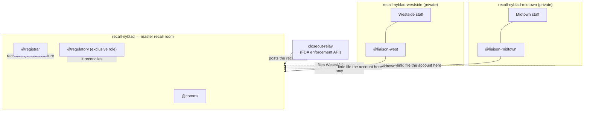

# Closeout

**A product recall is closed by reconciliation, never by assertion.**

Closeout is a Switch room where an agent holds a recall open until every
unit is accounted for, and refuses to let anyone — including the person
with regulatory authority — close it while product is still in the market.

Built for [Flip the Switch](https://www.wemakedevs.org/hackathons/switch)
(Track 01, Best Business Workflow).

---

## The problem

When a Class I recall goes out — the kind where eating the product can kill
you — the firm has to get it back. Almost nobody checks whether that
happened.

- The US GAO found that only about **36% of recalled food** was ever
  recovered, and that FDA's verification checks averaged **31 days**:
  longer than the shelf life of the product being recalled.
  ([GAO-05-51](https://webarchive.library.unt.edu/eot2008/20090813021452/http://gao.gov/products/GAO-05-51))
- HHS OIG found it took an average of **57 days** for a recall to even
  begin after FDA knew about the hazard.
  ([OIG, 2017](https://www.oversight.gov/sites/default/files/documents/reports/2017-09/11501500.pdf))

Here is the specific failure this project attacks. Run:

```bash
python3 -m closeout.cli fetch --recall F-0616-2018 --offline
```

That is a real FDA enforcement record: Nyblad Orchards apples, possible
*Listeria monocytogenes*, Class I, eleven lot numbers, **"5278 units
shipped"**. Its status is **Terminated** — the recall is closed.

Nowhere in that record is there any number for how many of the 5,278 units
came back. The recall was closed without anyone having to state it.

That is how 36% passes for success.

## What Closeout does

Every unit shipped to a consignee must end up in exactly one of four
buckets — **returned**, **destroyed**, **quarantined** off-sale, or
**dispensed** and therefore unrecoverable. The residue is unaccounted
product: it is somewhere in the market and nobody can point to it.

Closure requires all three of:

1. zero unaccounted units across every consignee,
2. a named final account from every consignee,
3. no contradiction outstanding.

A consignee reporting the recall complete while short of units is a
*contradiction*, not a closure. Saying it a second time does not help.

**Accounted for is not the same as recovered.** Dispensed units are
explained but were never got back, so the recovery rate is the honest
measure, and it is what the regulatory role signs for.

## Why this needs Switch

A recall is not one team in one channel. It is several organisations who
must not see each other's books, and one of them has legal authority the
others do not.

Switch's own guidance on shared context says it plainly:

> Membership is the boundary that matters here. [...] Separate rooms
> preserve the boundary.

So the structure is the product:



| Switch primitive | How Closeout uses it | Why it is load-bearing |
|---|---|---|
| **Room membership** | One private room per consignee. The registrar is a member of **none** of them. | A consignee must not see another's counts. The registrar structurally *cannot* read a consignee's working discussion, so it cannot be talked into helping one massage its numbers. Enforced by Switch, not by a prompt. |
| **Exclusive roles** | `@regulatory` is `exclusive: true`; `@comms` is shared. | Closure is a legal act by one named person. Switch records who answered, which is the audit trail a regulator needs. |
| **One-way links** | Consignee rooms link **to** the master room; the master never links back. | A room's name is visible to everyone in a room that links to it. Linking outward would disclose the whole consignee list to every consignee. |
| **Room documents** | The closure rule ships as a room doc. | Every agent that joins is briefed on the rule, so nobody has to ask what "closed" means. |
| **Agent as event relay** | `closeout-relay` posts the FDA notice via `POST /agents/{id}/message`. | Switch has no scheduler and no inbound webhook (the generic-webhook platform is [open issue #799](https://github.com/sandbox-quantum/switch/issues/799)), so an outside event reaches a room only through a registered agent. |
| **Templates** | `closeout.template.yaml` builds the whole group — 3 rooms, 3 agents, roles, docs, links — in one run. | The structure is reproducible, not hand-assembled. |

**Take Switch away and this is not a worse version of the same thing.** It
is a single channel in which every consignee reads every other consignee's
figures, which in a real recall is unlawful.

## The agent never does the arithmetic

`closeout/recon.py` is plain Python with no model in it. The registrar's
instructions are explicit:

> You never compute a number yourself and never estimate one. [...] A
> number you arrived at by reasoning is a fabrication here.

The agent runs the tool and reports what it printed. Every figure in the
room is reproducible by anyone with the repo, and a model that "rounds"
1,400 missing units to "a small remainder" cannot happen.

## Quickstart

No network, no API key, no Switch server, no virtualenv — the engine is
pure standard library:

```bash
git clone https://github.com/ANMOLGUPTA-24/closeout.git
cd closeout
./scripts/demo.sh
```

That runs both halves of the story end to end. It exits non-zero if a
recall is ever closed when it should not be, so it doubles as an
integration test.

**Run B is the point.** Westside returns 2,878 of 4,278 units and states
the recall is complete. Closure is refused as a contradiction. Then
`@regulatory` tries to authorize closure anyway, and is refused too:

```
CLOSURE REFUSED
  - Westside Distributors: reports the recall complete while 1400 of 4278
    units are still unaccounted for
  - 1400 units unaccounted for across 1 consignee(s)
```

Authority is not arithmetic.

**Run A** is what closing honestly looks like: the account balances, and
the recall closes at a **90.5%** recovery rate with 500 units explicitly
signed for as never recovered.

### Tests

```bash
python3 -m venv .venv && .venv/bin/pip install pytest
.venv/bin/python -m pytest tests/ -q
```

19 tests, weighted toward the refusal paths: false completion, overage,
duplicate accounts, silence-is-not-completion, and a guard against Python
counting `True` as one unit.

## Running it in Switch

Needs [Switch Console](https://docs.switchagents.ai/) with a local server
and its bundled Mattermost (Docker).

First record what was shipped to whom, which is the firm's distribution
data and the thing a recall is reconciled against:

```bash
python3 -m closeout.cli ship --recall F-0616-2018 \
    --consignee "Westside Distributors" --units 4278
python3 -m closeout.cli ship --recall F-0616-2018 \
    --consignee "Midtown Pharmacy" --units 1000
```

Then **Templates → Import template** in Console, choose
`closeout.template.yaml` from this repo, and run it with:

| Param | Value |
|---|---|
| `recall` | `nyblad` |
| `recall_number` | `F-0616-2018` |
| `product` | `Nyblad Orchards whole fresh apples, possible Listeria (Class I)` |
| `project_dir` | your clone of this repo |

The relay bot is separate, and only needed to post the FDA notice into the
room:

```bash
python3 scripts/register_relay.py     # writes ~/.config/closeout/relay.json, 0600
python3 scripts/provision.py --save-only   # saves the template over the API instead of importing it
```

Credentials are written at mode 0600 and are never printed.

## Honest limits

- **The template must be run from Switch Console, not headlessly.**
  `run_template` from a plain registered agent fails with
  `machine_unresolved`: creating managed agents needs an agent-controller
  machine and the "can manage agents" capability. Console is that machine.
  Everything else here is scriptable; this step is not.
- **Lot-to-consignee quantities are synthetic.** The recall record is real,
  and so is its 5,278-unit total, but openFDA does not publish who received
  which lot. The split across two consignees is invented, and labelled as
  such wherever it is used. Real records are frequently worse than this one:
  the first record I pulled had an empty `product_quantity` and a
  `code_info` of "No Lot code on label", which is itself much of why recalls
  cannot be reconciled today.
- **Two consignees, not a distribution tree.** A real Class I recall fans
  out through distributors to hundreds of retailers, and sub-consignees are
  not modelled.
- **Nothing here talks to a regulator.** No FDA submission, no 21 CFR 7
  workflow, no electronic signature. `@regulatory` is a role in a chat room,
  not an identity a regulator would accept.
- **The liaison is the one deliberate boundary crossing.** It is a member of
  its own consignee room *and* the master room, because filing an account is
  its job. Its instructions forbid carrying anything else across, and
  instructions are not an enforcement mechanism. The registrar's isolation
  *is* enforced, because it is a member of no consignee room at all.
- **Approval buttons need a callback URL.** Without one configured in
  Mattermost, people answer by typing rather than clicking.

## AI disclosure

Built with Claude Code (Claude Opus 5) during the hackathon window, used
for research, implementation and documentation. I directed the design,
chose the domain and the room structure, and reviewed everything in this
repository. The reconciliation rules, the demo scenario and the limits
above are mine and I can explain any of them.

Pre-existing work: none. The Switch setup, the template, the engine and the
workflow were all built during the event. `data/openfda-F-0616-2018.json` is
a verbatim public record from the FDA enforcement API (CC0).

## Licence

MIT.
