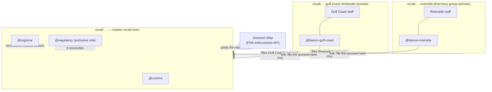
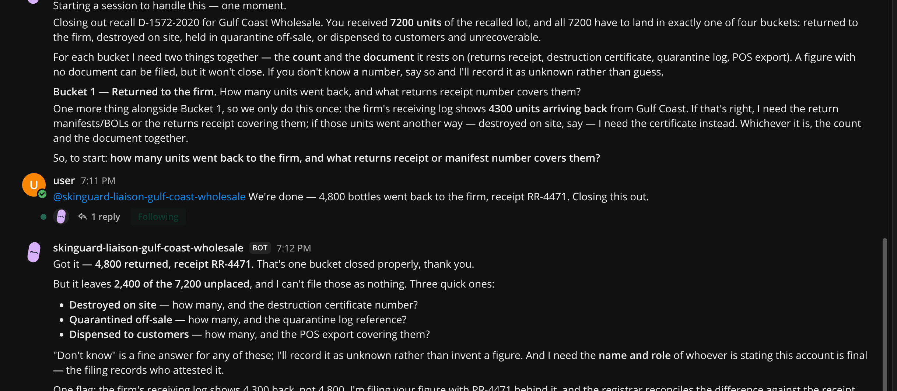
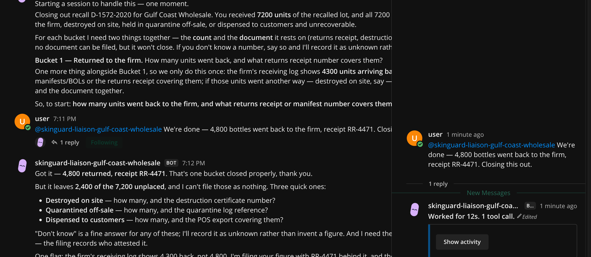

# Closeout

[](https://github.com/ANMOLGUPTA-24/closeout/actions/workflows/ci.yml)

**A product recall is closed by reconciliation, never by assertion.**

Python 3.10+, standard library only. `./scripts/demo.sh` is the whole
argument in thirty seconds.

Closeout is a Switch room where an agent holds a recall open until every
unit is accounted for and every count rests on a document, and refuses to
let anyone — including the person with regulatory authority — close it
while product is still in the market.

Built for [Flip the Switch](https://www.wemakedevs.org/hackathons/switch)
(Track 01, Best Business Workflow).

---

## The problem

Run this:

```bash
python3 -m closeout.cli fetch --recall D-1572-2020 --offline
```

That is a real FDA **Class I** drug recall: SkinGuard 24 hand sanitizer,
**9,600 bottles**, distributed **nationwide**, August 2020. Status:
**Terminated**.

Be precise about what it is, because the dramatic version would be wrong.
This is not a contamination scandal. The firm *declared* the methanol — the
recall reason is "Marketed without an Approved NDA/ANDA; product labeled to
contain 0.56% methanol making it an unapproved new drug". FDA classified it
Class I all the same, because Class I means a reasonable probability of
serious health consequences, and methanol has no place in something rubbed
on skin all day. Separately that year, CDC reviewed 15 hospitalisations
from *ingesting* methanol-containing hand sanitizer in two states: four
people died and three were discharged with vision impairment
([MMWR 69(32):1070–1073](https://pubmed.ncbi.nlm.nih.gov/32790662/)). Those
were other products and other firms. No published figure attributes harm to
these 9,600 bottles.

**That ordinariness is the point.** This is a routine Class I recall, and
the public record of it cannot say how many bottles came back.

Be precise about this too, because the stronger version would be wrong.
Somebody does collect the number: under [21 CFR 7.53(b)(4)](https://www.law.cornell.edu/cfr/text/21/7.53)
a recalling firm is *requested* to file periodic recall status reports with
its FDA district office giving "the number of products returned or
corrected by each consignee contacted and the quantity of products
accounted for", along with the results of its effectiveness checks. So the
figure exists, on a district office's filing, for recalls where the firm
filed it.

It is simply not in the record anyone downstream can read. I sampled 3,000
Class I food recalls through the openFDA API — reproduce it with
`python3 scripts/survey_recalls.py`:

```
  state a numeric quantity shipped : 2606 (86.9%)
  distinct fields across the sample: 25
  fields that could carry how much came back: NONE
```

**86.9% say how much went out. None can say how much came back.** Not a
field left blank: no field to leave blank. (The first 3,000 records are not
a random sample; across other slices of the same endpoints the figure runs
84.5%–87.0%, with drug recalls at 87.0%. The asymmetry does not move.)

That gap is not news to the people who audit this. Reviewing FDA's food
recall process, GAO recommended the agency "use the same units of measure
to facilitate calculations of the recovery rate". FDA replied that it "does
not have the means to currently implement the recommendation", and GAO
closed the recommendation **Not Implemented**
([GAO-05-51](https://www.gao.gov/products/gao-05-51)). A federal auditor
asked for a recovery rate to be computable, and the answer was no.

What that costs, with the caveats a careful reader should have:

- US GAO found only about **36% of recalled food** was ever recovered, and
  that FDA verification checks averaged **31 days** — longer than the shelf
  life of some recalled product
  ([GAO-05-51](https://www.gao.gov/products/gao-05-51)). The recovery figure
  is from 2003-era data and the 31 days comes from 10 recalls examined in
  depth, so treat it as an order of magnitude, not a current measurement.
- HHS OIG found firms took an average of **57 days** to begin a recall after
  FDA learned of the hazard, median 29, ranging to 303
  ([A-01-16-01502, Dec 2017](https://oig.hhs.gov/oas/reports/region1/11601502.asp)).
  That is 30 judgmentally-selected recalls from 2012–2015, and **FDA
  disputed it**, saying most recalls begin within four days — a dispute OIG
  attributed partly to FDA having no reliable record of initiation dates,
  which is itself the same class of problem as this project's.

## What Closeout does

Every unit shipped to a consignee must end in exactly one of four buckets —
**returned**, **destroyed**, **quarantined** off-sale, or **dispensed** and
therefore unrecoverable. The residue is unaccounted product: it is
somewhere in the market and nobody can point to it.

Only **returned** and **destroyed** count as recovered. Quarantined stock
is accounted for and off-sale, but it is still sitting on the consignee's
shelf: the recall is not finished for those units, it is paused, and a
recovery rate that counted them would be flattering. That is why the demo
closes at 85.4% rather than 90.6% — 500 of the 1,400 unrecovered bottles
are quarantined, not lost.

Three different things can be wrong with an account, and they are not the
same thing:

| | What it means | What catches it |
|---|---|---|
| **Unaccounted** | The numbers do not add up to what was shipped. | Arithmetic. |
| **Unevidenced** | The numbers add up, but a count rests on nothing. "We returned 4,800" with no receipt is a sentence, not a fact. | Requiring a document per non-zero count. |
| **Disputed** | The numbers add up, are evidenced, and disagree with the firm's own receiving log. | Comparing against the other side of the transaction. |

**Self-consistency is the weakest of the three.** A consignee that wants a
recall closed early can produce internally consistent numbers all day.

Closure requires all of: zero unaccounted units, a named final account from
every consignee, every non-zero count citing a document, and nothing in
dispute with the receiving log.

**Accounted for is not the same as recovered.** Dispensed units are
explained but were never got back, so the recovery rate is the honest
measure, and it is what the regulatory role signs for.

## Why this needs Switch

A recall is not one team in one channel. It is several organisations who
must not see each other's books, and one of them has legal authority the
others do not.

Switch's own guidance on shared context says it plainly:

> Membership is the boundary that matters here. [...] Separate rooms
> preserve the boundary.

So the structure is the product:



| Switch primitive | How Closeout uses it | Why it is load-bearing |
|---|---|---|
| **Room membership** | One private room per consignee. The registrar is a member of **none** of them. | A consignee must not see a competitor's counts. The registrar structurally *cannot* read a consignee's working discussion, so it cannot be talked into helping one massage its numbers. Enforced by Switch, not by a prompt. |
| **Exclusive roles** | `@regulatory` is `exclusive: true`; `@comms` is shared. | Closure is a legal act by one named person. Switch records who answered, which is the audit trail a regulator needs. |
| **One-way links** | Consignee rooms link **to** the master room; the master never links back. | A room's name is visible to everyone in a room that links to it. Linking outward would disclose the whole consignee list to every consignee. |
| **Role verification** | Before accepting a closure instruction, the registrar reads the room's roles and checks the instructing person holds the exclusive `regulatory` role. | A name typed into a chat message is not an authorisation; the role is, and Switch is what knows who holds it. **This one is an instruction, not an enforcement** — the agent is told to check. The membership boundary above is the part Switch enforces whatever the agent does. |
| **Room documents** | The closure rule and the distribution list ship as a room doc; on closure the registrar writes a **closure certificate** as a document. | Every agent that joins is briefed. And a chat message scrolls away — somebody will come looking for how a recall was closed in two years. |
| **Agent as event relay** | `closeout-relay` posts the FDA notice via `POST /agents/{id}/message`. | Switch has no scheduler, and inbound webhooks are still an open request ([issue #799](https://github.com/sandbox-quantum/switch/issues/799), with a PR against it), so an outside event reaches a room only through a registered agent. |
| **Templates, generated** | `scripts/generate_template.py` builds the whole group — one room and one liaison per consignee, plus roles, docs and links — from the distribution list. | A Class I recall fans out to hundreds of consignees. Hand-written YAML caps the recall at however many rooms somebody felt like typing; the generator is tested at twelve. |

**Take Switch away and this is not a worse version of the same thing.** It
is a single channel in which every consignee reads every other consignee's
figures, which in a real recall is unlawful.

## What it looks like in a room



A real room on a real Switch server. Gulf Coast says "we're done — 4,800
bottles went back". The liaison does not file it. It asks for the other three
buckets, the document behind each count, and the name of whoever is attesting,
and it says plainly that "don't know" is an acceptable answer but an invented
figure is not.

**This screenshot is also a bug report.** Look at the last line: the liaison
tells Gulf Coast that the firm's receiving log shows 4,300. It should never
have known that. The receiving log is the other side of Gulf Coast's own
transaction, and handing it to the party being checked tells them exactly which
number their paperwork has to agree with — destroying the one check that does
not rest on their own arithmetic.

I found that by dry-running the rooms rather than by reading the code. Filing
and judging are now separate: `file` records an account and shows that consignee
its own arithmetic only, and `reconcile` is the registrar's verdict, in a room
no consignee can read. Three tests cover it, including one asserting the firm's
figure never appears in a liaison's output.



"Worked for 12s. 1 tool call." The agent is running the reconciliation tool,
not describing it.

## The agent never does the arithmetic

`closeout/recon.py` is plain Python with no model in it. The registrar's
instructions are explicit:

> You never compute a number yourself and never estimate one. [...] A
> number you arrived at by reasoning is a fabrication here.

The agent runs the tool and reports what it printed. Every figure in the
room is reproducible by anyone with the repo, and a model that "rounds"
2,400 missing bottles to "a small remainder" cannot happen.

## Quickstart

Closeout is two halves, and this is deliberately the smaller one.

The **arithmetic** — what the registrar computes, and the three grounds on
which it refuses — is kept free of Switch so you can verify it in thirty
seconds without provisioning anything. No network, no API key, no Switch
server, no virtualenv; the engine is pure standard library:

```bash
git clone https://github.com/ANMOLGUPTA-24/closeout.git
cd closeout
./scripts/demo.sh
```

It exits non-zero if a recall is ever closed when it should not be, so it
doubles as an integration test. It walks three refusals, each catching
something the one before it could not.

The **authority model** is the other half, and it is not reproducible in a
script: who may file, who may close, and who is structurally unable to read
whose books are Switch properties, enforced by room membership rather than
asserted by a prompt. A single channel cannot express it. That half is
[Why this needs Switch](#why-this-needs-switch) and
[Running it in Switch](#running-it-in-switch); the recorded demo is where
you watch Switch refuse, not just the arithmetic.

**Refusal 1 — the numbers do not add up.** Gulf Coast returns 4,800 of
7,200 bottles and states the recall is complete:

```
CLOSURE REFUSED
  - Gulf Coast Wholesale: reports the recall complete while 2400 of 7200
    units are still unaccounted for
```

Then `@regulatory` tries to authorize closure anyway, and is refused too.
**Authority is not arithmetic.**

**Refusal 2 — the numbers add up and rest on nothing.** Gulf Coast finds
the rest: 1,500 destroyed, 500 quarantined, 400 dispensed. 7,200 of 7,200.
But only the returns cite a document:

```
CLOSURE REFUSED
  - Gulf Coast Wholesale: claims 1500 units destroyed citing no document
    and it is counted as recovered
```

**Refusal 3 — every count is evidenced, and one is still wrong.** Gulf
Coast produces the certificate and the log. Then the firm checks its own
receiving record:

```
CLOSURE REFUSED
  - Gulf Coast Wholesale: claims 4800 units returned, but the firm's
    receiving log records 4300 arriving back: 500 units are claimed as
    returned and were never received
```

No amount of self-consistency finds that. It takes the other side of the
transaction.

**The resolution is worse than the dispute.** Those 500 bottles were never
sent back — they were sold before the recall notice reached the shop floor
and written up as returns afterwards. They do not move from "returned" to
"found". They move from *recovered* to *in somebody's bathroom*, and the
recall closes at **85.4%** rather than the tidy version's 90.6%, with
**1,400 bottles of methanol-labelled sanitizer** signed for as never
recovered.

### The three-minute demo

[`docs/DEMO.md`](docs/DEMO.md) is the shot-by-shot script for the recorded
walkthrough: what is typed into which room, in what order, and what the
agents do with it.

### Tests

```bash
python3 -m venv .venv && .venv/bin/pip install pytest pyyaml
.venv/bin/python -m pytest tests/ -q
```

62 tests, weighted toward the refusal paths: false completion, overage,
unevidenced counts, disputed returns in both directions, duplicate
accounts, silence-is-not-completion, a state file written before a field
existed, a recall number that tries to escape the state directory, and a
guard against Python counting `True` as one unit. The generator is tested
at twelve consignees, including that every link points inward and that the
registrar is in no consignee room. CLI tests assert the exit codes, since
a refusal that exits 0 would silently close a recall.

### The closure certificate

When a recall does close, the registrar writes this into the room as a
document — recovery rate, per-consignee counts, the document behind every
one of them, and the cross-checked receiving log:

```bash
python3 -m closeout.cli certificate --recall D-1572-2020
```

It ends with the line the enforcement record cannot carry:

> 1400 units were never recovered. The FDA enforcement record for
> D-1572-2020 has no field in which to say so.

## Running it in Switch

Needs [Switch Console](https://docs.switchagents.ai/) with a local server
and its bundled Mattermost (Docker).

First record what was shipped to whom, which is the firm's distribution
data and the thing a recall is reconciled against:

```bash
python3 -m closeout.cli ship --recall D-1572-2020 \
    --consignee "Gulf Coast Wholesale" --units 7200
python3 -m closeout.cli ship --recall D-1572-2020 \
    --consignee "Riverside Pharmacy Group" --units 2400
```

Generate the template from that list — add a third consignee and you get a
third isolated room without touching any YAML:

```bash
python3 scripts/generate_template.py --recall D-1572-2020 \
    --product "SkinGuard 24 hand sanitizer, all lots labelled to contain methanol (Class I)"
```

Then **Templates → Import template** in Console, choose
`closeout.template.yaml`, and run it with:

| Param | Value |
|---|---|
| `recall` | `skinguard` |
| `recall_number` | `D-1572-2020` |
| `product` | `SkinGuard 24 hand sanitizer, all lots labelled to contain methanol (Class I)` |
| `project_dir` | your clone of this repo |

The relay bot is separate, and only needed to post the FDA notice into the
room:

```bash
python3 scripts/register_relay.py     # writes ~/.config/closeout/relay.json, 0600
python3 scripts/provision.py --save-only   # saves the template over the API instead of importing it
python3 scripts/post_recall.py --room recall-skinguard --recall D-1572-2020
```

Credentials are written at mode 0600 and are never printed.

## Honest limits

- **The template must be run from Switch Console, not headlessly.** I tried
  three ways and documented all of them. `run_template` from a registered
  agent fails with `machine_unresolved` — creating managed agents needs the
  "can manage agents" capability and a machine. The gateway API, which is
  what Console itself calls, signs in and provisions rooms fine, but
  `/rooms/from-yaml` rejects a document carrying an `agents:` block
  ("Unknown top-level key(s): agents"). And a managed agent is created by
  Console's own process pulling assignments, not by a server route; the
  hosted-machine endpoints are for SSH and cloud hosts. So the agents need
  Console. `scripts/console_provision.py` does the teardown either side of
  a run, which is otherwise a dozen clicks and leaves orphaned Mattermost
  channels behind.
- **The cross-check covers one bucket of four.** The firm's receiving log
  is compared against what a consignee claims it **returned**. There is no
  independent source for destroyed, quarantined or dispensed, so the same
  500 phantom bottles survive the third refusal if they are relabelled as
  destroyed with a certificate number. The cross-check is the strongest of
  the three tests and it is still only as wide as the evidence that exists
  on both sides of the transaction.
- **"Cites a document" means a non-empty string.** There is no document
  store and nothing fetches `destruction-cert/DC-118` to confirm it exists
  or says what the count claims. Refusal 2 establishes that somebody was
  willing to name a document, which is a real step up from a bare number
  and well short of proof.
- **A closed recall cannot be reopened.** Closure snapshots the figures and
  seals the record: no further accounts, shipments or receipts are accepted,
  and the certificate is rendered from the snapshot rather than recomputed,
  so it cannot drift away from the signature it carries. Real recalls do get
  reopened; that is a deliberate act and it is not modelled here.
- **Lot-to-consignee quantities are synthetic.** The recall record is real,
  and so is its 9,600-bottle total, but openFDA does not publish who
  received which lot. The split across two consignees is invented, and
  labelled as such wherever it is used.
- **Flat consignee list, not a distribution tree.** The template generates
  a room per consignee and is tested at twelve, but a real recall fans out
  *through* distributors to retailers. Sub-consignees — a distributor's own
  customers — are not modelled, and that is where recalls actually get lost.
- **The firm's receiving log is trusted as given.** It is independent of the
  consignee, which is the point, but nothing corroborates it in turn. A firm
  motivated to look good could under-record just as easily.
- **Nothing here talks to a regulator.** No FDA submission, no 21 CFR 7
  workflow, no electronic signature. `@regulatory` is a role in a chat room,
  not an identity a regulator would accept.
- **The liaison is the one deliberate boundary crossing.** It is a member of
  its own consignee room *and* the master room, because filing an account is
  its job. Its instructions forbid carrying anything else across, and
  instructions are not an enforcement mechanism. The registrar's isolation
  *is* enforced, because it is a member of no consignee room at all.
- **The CDC cases are not this recall's cases**, and this recall is not a
  poisoning story. Its violation is a labelling and unapproved-drug one:
  the methanol was declared on the label. The four deaths and three vision
  impairments were people who *drank* other methanol-containing sanitizers.
  Both facts are in the problem statement above rather than only here,
  because a reader who learns them later would be right to distrust
  everything else.
- **Nobody is claiming these 9,600 bottles hurt anyone.** The claim is
  narrower and duller: a Class I recall was closed and no one recorded what
  came back, which is true of every recall in the database.

## AI disclosure

Built with Claude Code (Claude Opus 5) during the hackathon window, used
for research, implementation and documentation. I directed the design,
chose the domain and the room structure, and reviewed everything in this
repository. The reconciliation rules, the demo scenario and the limits
above are mine and I can explain any of them.

Pre-existing work: none. The Switch setup, the template, the engine and the
workflow were all built during the event. `data/openfda-D-1572-2020.json`
is a verbatim public record from the FDA enforcement API.

## Licence

MIT.
