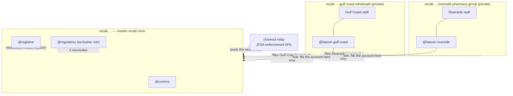

# Closeout

**A product recall is closed by reconciliation, never by assertion.**

Closeout is a Switch room where an agent holds a recall open until every
unit is accounted for and every count rests on a document, and refuses to
let anyone — including the person with regulatory authority — close it
while product is still in the market.

Built for [Flip the Switch](https://www.wemakedevs.org/hackathons/switch)
(Track 01, Best Business Workflow).

---

## The problem

Run this:

```bash
python3 -m closeout.cli fetch --recall D-1572-2020 --offline
```

That is a real FDA Class I drug recall. SkinGuard 24 hand sanitizer,
**"all lots labeled to contain methanol"**, **9,600 bottles**, distributed
**nationwide**, August 2020.

Methanol is lethal swallowed and causes permanent blindness short of that.
Over two months in 2020, CDC reviewed 15 hospitalisations from
methanol-contaminated hand sanitizer across two states: **four people died
and three were left permanently blind**
([MMWR 69(32):1070–1073](https://pubmed.ncbi.nlm.nih.gov/32790662/)).
Those cases are not attributed to this particular recall — they are why
this entire product category is Class I.

So: how many of the 9,600 bottles came back?

The record does not say. Its status is **Terminated** — closed — and there
is no field anywhere in it for how much was recovered.

I sampled 3,000 Class I food recalls through the openFDA API to check
whether this is an outlier. **86.9% state a numeric quantity shipped. None
state how much came back**, because the enforcement schema has no such
field. It is not missing data. It is a missing concept.

The consequences are measurable:

- US GAO found only about **36% of recalled food** was ever recovered, with
  FDA verification averaging **31 days** — longer than the shelf life of the
  product being recalled
  ([GAO-05-51](https://webarchive.library.unt.edu/eot2008/20090813021452/http://gao.gov/products/GAO-05-51))
- HHS OIG found an average of **57 days** for a recall to even begin after
  FDA knew about the hazard
  ([OIG, 2017](https://www.oversight.gov/sites/default/files/documents/reports/2017-09/11501500.pdf))

## What Closeout does

Every unit shipped to a consignee must end in exactly one of four buckets —
**returned**, **destroyed**, **quarantined** off-sale, or **dispensed** and
therefore unrecoverable. The residue is unaccounted product: it is
somewhere in the market and nobody can point to it.

Three different things can be wrong with an account, and they are not the
same thing:

| | What it means | What catches it |
|---|---|---|
| **Unaccounted** | The numbers do not add up to what was shipped. | Arithmetic. |
| **Unevidenced** | The numbers add up, but a count rests on nothing. "We returned 4,800" with no receipt is a sentence, not a fact. | Requiring a document per non-zero count. |
| **Disputed** | The numbers add up, are evidenced, and disagree with the firm's own receiving log. | Comparing against the other side of the transaction. |

**Self-consistency is the weakest of the three.** A consignee that wants a
recall closed early can produce internally consistent numbers all day.

Closure requires all of: zero unaccounted units, a named final account from
every consignee, every non-zero count citing a document, and nothing in
dispute with the receiving log.

**Accounted for is not the same as recovered.** Dispensed units are
explained but were never got back, so the recovery rate is the honest
measure, and it is what the regulatory role signs for.

## Why this needs Switch

A recall is not one team in one channel. It is several organisations who
must not see each other's books, and one of them has legal authority the
others do not.

Switch's own guidance on shared context says it plainly:

> Membership is the boundary that matters here. [...] Separate rooms
> preserve the boundary.

So the structure is the product:



| Switch primitive | How Closeout uses it | Why it is load-bearing |
|---|---|---|
| **Room membership** | One private room per consignee. The registrar is a member of **none** of them. | A consignee must not see a competitor's counts. The registrar structurally *cannot* read a consignee's working discussion, so it cannot be talked into helping one massage its numbers. Enforced by Switch, not by a prompt. |
| **Exclusive roles** | `@regulatory` is `exclusive: true`; `@comms` is shared. | Closure is a legal act by one named person. Switch records who answered, which is the audit trail a regulator needs. |
| **One-way links** | Consignee rooms link **to** the master room; the master never links back. | A room's name is visible to everyone in a room that links to it. Linking outward would disclose the whole consignee list to every consignee. |
| **Room documents** | The closure rule and the distribution list ship as a room doc. | Every agent that joins is briefed, so nobody has to ask what "closed" means. |
| **Agent as event relay** | `closeout-relay` posts the FDA notice via `POST /agents/{id}/message`. | Switch has no scheduler and no inbound webhook ([issue #799](https://github.com/sandbox-quantum/switch/issues/799)), so an outside event reaches a room only through a registered agent. |
| **Templates, generated** | `scripts/generate_template.py` builds the whole group — one room and one liaison per consignee, plus roles, docs and links — from the distribution list. | A Class I recall fans out to hundreds of consignees. Hand-written YAML caps the recall at however many rooms somebody felt like typing; the generator is tested at twelve. |

**Take Switch away and this is not a worse version of the same thing.** It
is a single channel in which every consignee reads every other consignee's
figures, which in a real recall is unlawful.

## The agent never does the arithmetic

`closeout/recon.py` is plain Python with no model in it. The registrar's
instructions are explicit:

> You never compute a number yourself and never estimate one. [...] A
> number you arrived at by reasoning is a fabrication here.

The agent runs the tool and reports what it printed. Every figure in the
room is reproducible by anyone with the repo, and a model that "rounds"
2,400 missing bottles to "a small remainder" cannot happen.

## Quickstart

No network, no API key, no Switch server, no virtualenv — the engine is
pure standard library:

```bash
git clone https://github.com/ANMOLGUPTA-24/closeout.git
cd closeout
./scripts/demo.sh
```

It exits non-zero if a recall is ever closed when it should not be, so it
doubles as an integration test. It walks three refusals, each catching
something the one before it could not.

**Refusal 1 — the numbers do not add up.** Gulf Coast returns 4,800 of
7,200 bottles and states the recall is complete:

```
CLOSURE REFUSED
  - Gulf Coast Wholesale: reports the recall complete while 2400 of 7200
    units are still unaccounted for
```

Then `@regulatory` tries to authorize closure anyway, and is refused too.
**Authority is not arithmetic.**

**Refusal 2 — the numbers add up and rest on nothing.** Gulf Coast finds
the rest: 1,500 destroyed, 500 quarantined, 400 dispensed. 7,200 of 7,200.
But only the returns cite a document:

```
CLOSURE REFUSED
  - Gulf Coast Wholesale: claims 1500 units destroyed citing no document
    and it is counted as recovered
```

**Refusal 3 — every count is evidenced, and one is still wrong.** Gulf
Coast produces the certificate and the log. Then the firm checks its own
receiving record:

```
CLOSURE REFUSED
  - Gulf Coast Wholesale: claims 4800 units returned, but the firm's
    receiving log records 4300 arriving back: 500 units are claimed as
    returned and were never received
```

No amount of self-consistency finds that. It takes the other side of the
transaction.

**The resolution is worse than the dispute.** Those 500 bottles were never
sent back — they were sold before the recall notice reached the shop floor
and written up as returns afterwards. They do not move from "returned" to
"found". They move from *recovered* to *in somebody's bathroom*, and the
recall closes at **85.4%** rather than the tidy version's 90.6%, with
**1,400 bottles of methanol-labelled sanitizer** signed for as never
recovered.

### Tests

```bash
python3 -m venv .venv && .venv/bin/pip install pytest pyyaml
.venv/bin/python -m pytest tests/ -q
```

44 tests, weighted toward the refusal paths: false completion, overage,
unevidenced counts, disputed returns in both directions, duplicate
accounts, silence-is-not-completion, a state file written before a field
existed, a recall number that tries to escape the state directory, and a
guard against Python counting `True` as one unit. The generator is tested
at twelve consignees, including that every link points inward and that the
registrar is in no consignee room.

## Running it in Switch

Needs [Switch Console](https://docs.switchagents.ai/) with a local server
and its bundled Mattermost (Docker).

First record what was shipped to whom, which is the firm's distribution
data and the thing a recall is reconciled against:

```bash
python3 -m closeout.cli ship --recall D-1572-2020 \
    --consignee "Gulf Coast Wholesale" --units 7200
python3 -m closeout.cli ship --recall D-1572-2020 \
    --consignee "Riverside Pharmacy Group" --units 2400
```

Generate the template from that list — add a third consignee and you get a
third isolated room without touching any YAML:

```bash
python3 scripts/generate_template.py --recall D-1572-2020 \
    --product "SkinGuard 24 hand sanitizer, all lots labelled to contain methanol (Class I)"
```

Then **Templates → Import template** in Console, choose
`closeout.template.yaml`, and run it with:

| Param | Value |
|---|---|
| `recall` | `skinguard` |
| `recall_number` | `D-1572-2020` |
| `product` | `SkinGuard 24 hand sanitizer, all lots labelled to contain methanol (Class I)` |
| `project_dir` | your clone of this repo |

The relay bot is separate, and only needed to post the FDA notice into the
room:

```bash
python3 scripts/register_relay.py     # writes ~/.config/closeout/relay.json, 0600
python3 scripts/provision.py --save-only   # saves the template over the API instead of importing it
python3 scripts/post_recall.py --room recall-skinguard --recall D-1572-2020
```

Credentials are written at mode 0600 and are never printed.

## Honest limits

- **The template must be run from Switch Console, not headlessly.**
  `run_template` from a plain registered agent fails with
  `machine_unresolved`: creating managed agents needs an agent-controller
  machine and the "can manage agents" capability. Console is that machine.
  Everything else here is scriptable; this step is not.
- **Lot-to-consignee quantities are synthetic.** The recall record is real,
  and so is its 9,600-bottle total, but openFDA does not publish who
  received which lot. The split across two consignees is invented, and
  labelled as such wherever it is used.
- **Flat consignee list, not a distribution tree.** The template generates
  a room per consignee and is tested at twelve, but a real recall fans out
  *through* distributors to retailers. Sub-consignees — a distributor's own
  customers — are not modelled, and that is where recalls actually get lost.
- **The firm's receiving log is trusted as given.** It is independent of the
  consignee, which is the point, but nothing corroborates it in turn. A firm
  motivated to look good could under-record just as easily.
- **Nothing here talks to a regulator.** No FDA submission, no 21 CFR 7
  workflow, no electronic signature. `@regulatory` is a role in a chat room,
  not an identity a regulator would accept.
- **The liaison is the one deliberate boundary crossing.** It is a member of
  its own consignee room *and* the master room, because filing an account is
  its job. Its instructions forbid carrying anything else across, and
  instructions are not an enforcement mechanism. The registrar's isolation
  *is* enforced, because it is a member of no consignee room at all.
- **The CDC deaths are not this recall's deaths.** Four deaths and three
  blindings are what methanol-contaminated sanitizer did in two states over
  two months in 2020. No published figure attributes harm to these
  particular 9,600 bottles — which is rather the point, since nobody knows
  where 1,400 of them went.

## AI disclosure

Built with Claude Code (Claude Opus 5) during the hackathon window, used
for research, implementation and documentation. I directed the design,
chose the domain and the room structure, and reviewed everything in this
repository. The reconciliation rules, the demo scenario and the limits
above are mine and I can explain any of them.

Pre-existing work: none. The Switch setup, the template, the engine and the
workflow were all built during the event. `data/openfda-D-1572-2020.json`
is a verbatim public record from the FDA enforcement API.

## Licence

MIT.
